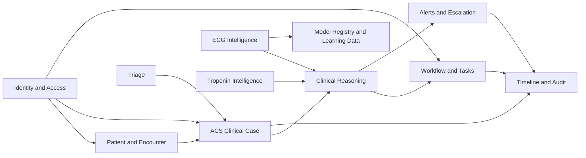

# Bounded Contexts

## Relationship Map

Cross-context dependencies are versioned events, IDs, and application-facing DTOs. A context never imports another context's domain aggregate or ORM model.

## Patient and Encounter

- **Responsibility:** Maintain local patient reference and encounter context needed to open an ACS case.
- **Aggregate roots:** `Patient`, `Encounter`; **entities:** patient and encounter; **value objects:** `PatientReference`, `EncounterReference`, `DemographicsSnapshot`, `EncounterLocation`.
- **Commands / queries:** `RegisterPatient`, `StartEncounter`, `UpdateEncounterLocation`; `GetPatient`, `GetEncounter`, `ListPatientEncounters`.
- **Domain events:** `PatientRegistered.v1`, `EncounterStarted.v1`.
- **Inbound ports:** registration/encounter handlers and query service. **Outbound ports:** patient/encounter repositories, UoW, audit publisher, clock, actor context.
- **Dependencies:** Identity and Access actor reference; supplies IDs to ACS Clinical Case. **Prohibited:** ECG/troponin providers, clinical rules, task or alert writes.
- **Data ownership:** locally entered patient/encounter metadata only; it is not an EHR master record.

## ACS Clinical Case

- **Responsibility:** Own suspected-ACS case lifecycle and link immutable evidence references to an encounter.
- **Aggregate roots:** `ClinicalCase` with optimistic version; **entities:** `CaseEvidenceLink`, `CaseStatusTransition`; **value objects:** `ClinicalCaseId`, `CaseStatus`, `SuspectedACSReason`, `EvidenceReference`.
- **Commands / queries:** `OpenClinicalCase`, `AttachEvidenceToCase`, `CloseClinicalCase`; `GetClinicalCase`, `ListOpenCases`, `GetCaseDashboard`.
- **Domain events:** `ClinicalCaseOpened.v1`, `CaseClosed.v1`.
- **Inbound ports:** case command/query handlers. **Outbound ports:** case repository, UoW, event publisher, clock, actor context.
- **Dependencies:** Patient/Encounter IDs; supplies case ID to all downstream contexts. **Prohibited:** direct model execution, clinical thresholds, SQLAlchemy in domain.
- **Data ownership:** case status, opening reason, linked evidence IDs, state-transition history.

## Triage

- **Responsibility:** Capture stated symptoms and observed vital signs without diagnosing them.
- **Aggregate roots:** `TriageAssessment`; **entities:** `SymptomRecord`, `VitalMeasurement`; **value objects:** `SymptomSnapshot`, `VitalSet`, `MeasurementProvenance`, `RecordedAt`.
- **Commands / queries:** `RecordSymptoms`, `RecordVitals`, `AmendTriageAssessment`; `GetTriageAssessment`, `GetLatestVitals`.
- **Domain events:** `SymptomsRecorded.v1`, `VitalsRecorded.v1`.
- **Inbound ports:** triage command/query handlers. **Outbound ports:** triage repository, UoW, event publisher, clock, actor context.
- **Dependencies:** Clinical Case ID; facts feed Clinical Reasoning. **Prohibited:** pathway recommendation, cath-lab action, AI provider import.
- **Data ownership:** symptoms/vitals as recorded facts and their provenance, not inferred diagnoses.

## ECG Intelligence

- **Responsibility:** Register ECG study references, assess declared input quality, request normalized AI analysis, and retain model provenance.
- **Aggregate roots:** `ECGStudy`, `AIAnalysis`; **entities:** `ECGInput`, `Prediction`, `ExplanationReference`; **value objects:** `ECGStudyId`, `ECGInputReference`, `ECGQualityAssessment`, `NormalizedAIResult`, `ModelProvenance`.
- **Commands / queries:** `UploadECG`, `AssessECGQuality`, `RequestAIAnalysis`, `RequestAIExplanation`; `GetECGStudy`, `GetAIAnalysis`, `GetModelInfo`.
- **Domain events:** `ECGUploaded.v1`, `ECGQualityAssessed.v1`, `AIAnalysisRequested.v1`, `AIAnalysisCompleted.v1`, `AIAnalysisFailed.v1`.
- **Inbound ports:** ECG command/query handlers. **Outbound ports:** ECG repository, evidence storage, `ECGAIProvider`, model registry query, UoW, event publisher.
- **Dependencies:** Clinical Case ID; Model Registry metadata; results are evidence for Clinical Reasoning. **Prohibited:** task/alert writes, cath-lab activation, torch/timm/ONNX imports except inside an infrastructure adapter.
- **Data ownership:** ECG metadata, immutable input reference, quality assessment, normalized result, explanation reference, model provenance.

## Troponin Intelligence

- **Responsibility:** Record ordered, collected, and resulted troponin measurements; calculate transparent deltas from recorded values.
- **Aggregate roots:** `TroponinSeries`; **entities:** `TroponinMeasurement`; **value objects:** `TroponinOrderReference`, `TroponinValue`, `MeasurementUnit`, `CollectionTime`, `TroponinDelta`.
- **Commands / queries:** `OrderTroponin`, `RecordTroponinCollection`, `RecordTroponinResult`, `CalculateTroponinDelta`; `GetTroponinSeries`, `GetLatestTroponin`, `GetTroponinDeltas`.
- **Domain events:** `TroponinOrdered.v1`, `TroponinCollected.v1`, `TroponinResulted.v1`.
- **Inbound ports:** troponin command/query handlers. **Outbound ports:** troponin repository, UoW, event publisher, clock, future laboratory adapter.
- **Dependencies:** Clinical Case ID; emits recorded facts for Clinical Reasoning. **Prohibited:** hidden thresholds, ECG model imports, direct task creation.
- **Data ownership:** values, units, timestamps, source reference, calculation formula/version and delta result.

## Clinical Reasoning

- **Responsibility:** Produce transparent, review-required pathway suggestions from facts. Every output is explicitly a demo rule, not clinical advice.
- **Aggregate roots:** `ClinicalPathwayAssessment`; **entities:** `EvidenceAssessment`, `RuleEvaluation`; **value objects:** `RulesetVersion`, `PathwaySuggestion`, `EvidenceConflict`, `SafetyConstraint`.
- **Commands / queries:** `EvaluateClinicalPathway`, `DetectEvidenceConflict`, `RequestPhysicianReview`; `GetPathwayAssessment`, `ExplainPathwayAssessment`.
- **Domain events:** `ClinicalPathwaySuggested.v1`, `PhysicianReviewRequested.v1`.
- **Inbound ports:** reasoning command/query handlers. **Outbound ports:** assessment repository, case/triage/ECG/troponin read ports, ruleset repository, UoW, event publisher.
- **Dependencies:** consumes facts from Case, Triage, ECG and Troponin; requests work/alerts. **Prohibited:** guideline hard-coding from memory, direct cath-lab/case mutation, AI framework imports.
- **Data ownership:** ruleset version, evaluated facts, outcome wording, conflicts, explanation of each rule evaluation.

## Workflow and Tasks

- **Responsibility:** Coordinate human review work and enforce physician confirmation for consequential workflow decisions.
- **Aggregate roots:** `ClinicalTask`, `PhysicianReview`; **entities:** `TaskAssignment`, `TaskCompletion`; **value objects:** `TaskType`, `TaskStatus`, `AssigneeReference`, `PhysicianConfirmation`.
- **Commands / queries:** `CreateTask`, `CompleteTask`, `RecordPhysicianDecision`, `RequestRepeatECG`, `RequestCathLabReview`, `RequestTransfer`; `GetTask`, `ListCaseTasks`, `GetPhysicianReview`.
- **Domain events:** `RepeatECGRequested.v1`, `RepeatECGDue.v1`, `PhysicianDecisionRecorded.v1`, `TaskCreated.v1`, `TaskCompleted.v1`, `CathLabReviewRequested.v1`, `TransferRequested.v1`.
- **Inbound ports:** task/confirmation command/query handlers. **Outbound ports:** task/review repositories, UoW, event publisher, clock, actor context.
- **Dependencies:** Clinical Reasoning requests work; Alerts reference tasks; Case supplies ID. **Prohibited:** autonomous cath-lab activation, raw model score interpretation, direct UI mutation.
- **Data ownership:** task lifecycle, assignment, due time, physician confirmation, reason and completion provenance.

## Alerts and Escalation

- **Responsibility:** Raise, acknowledge, and resolve review/safety alerts without making clinical decisions.
- **Aggregate roots:** `ClinicalAlert`; **entities:** `AlertAcknowledgement`, `AlertResolution`; **value objects:** `AlertType`, `AlertSeverity`, `AlertStatus`, `AlertReason`.
- **Commands / queries:** `RaiseAlert`, `AcknowledgeAlert`, `ResolveAlert`; `GetAlert`, `ListCaseAlerts`, `ListActiveAlerts`.
- **Domain events:** `AlertRaised.v1`, `AlertAcknowledged.v1`.
- **Inbound ports:** alert command/query handlers and idempotent event handlers. **Outbound ports:** alert repository, UoW, event publisher, clock, actor context.
- **Dependencies:** consumes reasoning/workflow events and references case ID. **Prohibited:** close case, invoke AI, issue diagnostic or cath-lab instruction.
- **Data ownership:** alert type, source event, status, acknowledgement/resolution provenance.

## Timeline and Audit

- **Responsibility:** Maintain immutable, queryable chronology of commands, decisions, state transitions, and delivered domain events.
- **Aggregate roots:** append-only `AuditEntry`; **entities:** `TimelineItem`; **value objects:** `AuditActor`, `AuditAction`, `EventEnvelopeReference`, `OccurredAtUtc`.
- **Commands / queries:** internal `AppendAuditEntry`; `GetCaseTimeline`, `GetAuditHistory`, `GetEventDeliveryStatus`.
- **Domain events:** consumes every catalogued event; emits no independent clinical business event.
- **Inbound ports:** projection/event-handler ports and audit query service. **Outbound ports:** audit/timeline projection repositories, UoW, clock.
- **Dependencies:** references IDs/events from all contexts. **Prohibited:** mutate source aggregate state, delete audit entries, perform medical inference.
- **Data ownership:** immutable audit metadata, canonical event references, timeline read model.

## Model Registry and Learning Data

- **Responsibility:** Register model metadata and capture de-identified learning-data references only when future governance permits.
- **Aggregate roots:** `ModelVersion`, `LearningDataReference`; **entities:** `ModelArtifact`, `ModelHealthSnapshot`; **value objects:** `ModelName`, `ModelVersionId`, `ModelCapability`, `ArtifactDigest`, `InputContract`.
- **Commands / queries:** `RegisterModelVersion`, `RecordModelHealth`, `RegisterLearningDataReference`; `GetModelVersion`, `ListModelVersions`, `GetModelHealth`.
- **Domain events:** registry administration remains internal; prediction provenance is in `AIAnalysisCompleted.v1`.
- **Inbound ports:** model registry command/query handlers. **Outbound ports:** model repository, artifact metadata store, health provider adapter, UoW, clock.
- **Dependencies:** provides immutable metadata to ECG Intelligence. **Prohibited:** pathway outcomes, training code in domain/application, mutation of research artifacts.
- **Data ownership:** model identity/version, input contract, capability, validation metadata reference, health snapshots.

## Identity and Access Placeholder

- **Responsibility:** Provide typed actor and role context until a real identity provider is integrated.
- **Aggregate roots:** optional `ActorProfile`; **entities:** `ActorProfile`; **value objects:** `ActorId`, `Role`, `ActorContext`.
- **Commands / queries:** `ProvisionDemoActor`, `DeactivateDemoActor`; `GetCurrentActor`, `GetActorProfile`.
- **Domain events:** administrative audit only; no clinical domain event.
- **Inbound ports:** actor-context provider and administrative handlers. **Outbound ports:** future actor repository/identity adapter, clock, audit publisher.
- **Dependencies:** all other contexts consume `ActorContext` through a port. **Prohibited:** UI-only authorization, clinical policy, patient data ownership.
- **Data ownership:** minimal actor/role reference; no credentials stored in MVP.

