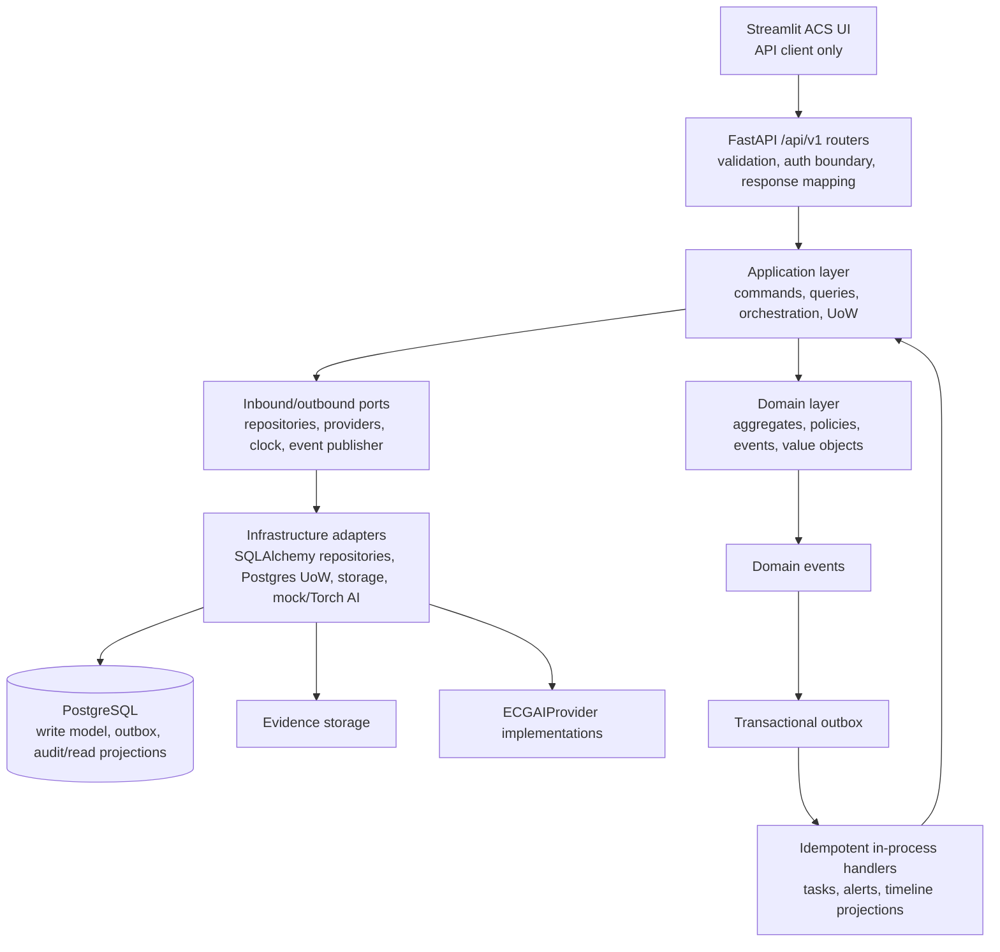

# Backend Component View

## Component Responsibilities

| Component | May do | Must not do |
|---|---|---|
| Router | Parse/version requests, invoke one inbound port, map known errors | Hold rules, query ORM, call model adapters directly |
| Application service | Open UoW, load aggregate, invoke domain behavior, persist, collect events | Embed framework/database/model details |
| Domain aggregate/policy | Enforce invariants and emit domain events | Import FastAPI, SQLAlchemy, Streamlit, torch/timm/ONNX |
| Repository port | Express aggregate persistence need | Expose ORM session/query APIs |
| UoW port | Define commit/rollback and repository scope | Decide clinical policy |
| Provider port | Define normalized ECG/troponin contracts | Leak tensors or checkpoint internals |
| Infrastructure adapter | Translate external API/database/model format | Introduce business decisions |
| Read-model query handler | Build case/timeline projections where useful | Mutate aggregates |

## CQRS Boundary

Commands mutate one or more aggregates inside an explicit unit of work and write outbox events atomically. Queries return read-only DTOs from projection tables or repositories. CQRS is limited to case dashboard, timeline, audit history, task queue, and model registry views; it does not require separate databases or services.

