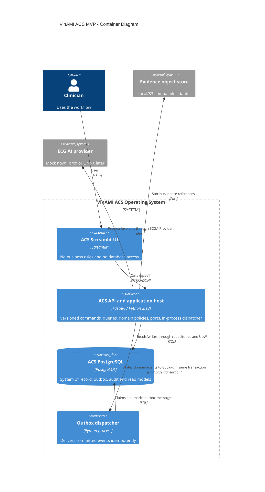

# Container View

## Containers

| Container | Responsibility | Technology target | Data access |
|---|---|---|---|
| ACS Streamlit UI | Case-oriented human interface; renders API responses and submits commands | Streamlit | Versioned FastAPI only |
| ACS API and application host | Commands, queries, domain policies, event dispatch, health checks | FastAPI, Python 3.12 | Application ports only |
| PostgreSQL | System-of-record tables, outbox, audit/timeline projections | PostgreSQL | Infrastructure repositories/unit of work only |
| Outbox dispatcher | Reliably dispatches committed domain events in-process in the MVP | Same deployable application | Transactional outbox repository |
| Evidence object store | References ECG files and exported research summaries | Local volume in dev; S3-compatible adapter later | Evidence storage port only |
| ECG provider adapter | Runs deterministic mock analysis or isolated Torch/ONNX integration | Infrastructure adapter | `ECGAIProvider` port only |

## Runtime Constraints

- FastAPI is the sole system-of-record interface. UI calls `/api/v1` and does not import domain services or SQLAlchemy.
- The dispatcher is logically separate but may run in the same process or a second Compose process. It is not a distributed message broker.
- The optional Torch adapter may mount the preserved artifact read-only. It never writes to `VinStroke_ECG_artifacts`.
- PostgreSQL holds metadata and audit records; large ECG files and exports are addressed by immutable input/output references.

