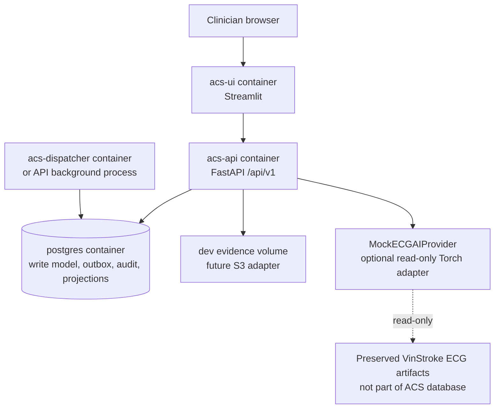

# Deployment View

## Docker Compose MVP

- Sprint 2 introduces `vinami-acs/docker-compose.yml` with `postgres`, `redis`, `api`, `dashboard`, `worker`, and `prometheus` services. The API image is Python 3.12; dashboard and worker reuse the same image.
- `postgres` is the only database. Local volumes are used only for development data and evidence references.
- API liveness is exposed at `/health`, readiness probes PostgreSQL at `/ready`, and `/metrics` exposes Prometheus metrics. API health checks gate dashboard and Prometheus startup. Secrets are injected by environment variables and are never committed.
- The preserved ECG artifacts are optional, read-only mounts. The MVP must work with `MockECGAIProvider` and no GPU.
- Production deployment topology, backup/restore, IAM, encryption keys, telemetry retention, and high availability remain unresolved and are out of Sprint 0 scope.
