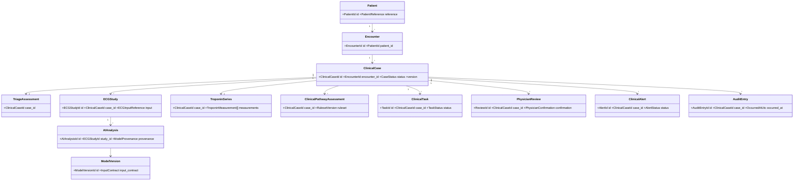

# Domain Model

## Aggregate Map

## Invariants

| Aggregate | Required invariant |
|---|---|
| `ClinicalCase` | Has one encounter; may close only through an auditable command; write version must match expected version. |
| `ECGStudy` | Uses immutable input reference; analysis result always includes model name, version, timestamp and input reference. |
| `AIAnalysis` | Is a normalized evidence record, not a diagnosis; it cannot cause cath-lab activation or case closure. |
| `TroponinSeries` | Delta records state which two measurements and calculation version produced them; units must be explicit. |
| `ClinicalPathwayAssessment` | Stores ruleset version, facts used, conflicts and visible demo-rule statement; never emits a rule-out conclusion. |
| `PhysicianReview` | Consequential workflow action requires a typed physician confirmation and actor/timestamp provenance. |
| `ClinicalTask` | Completion records actor, time and outcome; duplicate command IDs must not create duplicate work. |
| `ClinicalAlert` | Has source, case, status and acknowledgement provenance; resolution does not delete history. |
| `AuditEntry` | Append-only and UTC timestamped; source aggregate remains authoritative. |

## Shared Value Object Rules

- IDs are UUIDs, timestamps are timezone-aware UTC, and command IDs are UUIDs supplied by the caller or generated at the API boundary.
- `EvidenceReference` identifies stored content by URI/key, checksum when available, media type, and capture/upload provenance. The database does not treat a mutable filename as clinical evidence.
- `NormalizedAIResult` contains output labels/scores, provider/model provenance, processing state, and explicit limitations. It never exposes tensors, checkpoints, or adapter-specific payloads.
- `RulesetVersion` identifies a reviewed demonstration ruleset. It does not encode remembered clinical guideline thresholds.

