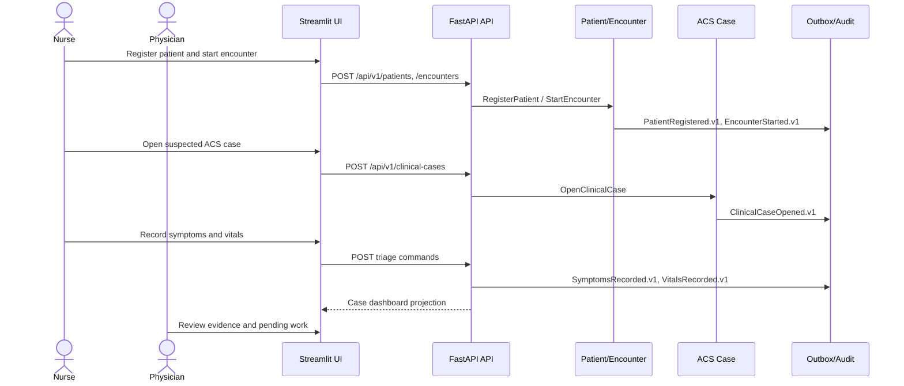
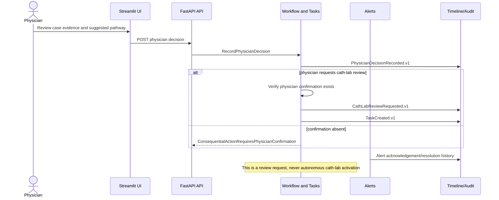

# Sequence Flows

## Patient Arrival to Clinical Review



## ECG Upload to AI Result

```mermaid
sequenceDiagram
  actor Nurse
  participant UI as Streamlit UI
  participant API as FastAPI API
  participant ECG as ECG Intelligence
  participant Store as Evidence Storage
  participant AI as ECGAIProvider
  participant Outbox as Transactional Outbox
  Nurse->>UI: Upload/select ECG study
  UI->>API: POST /api/v1/cases/{id}/ecg-studies
  API->>Store: Store immutable evidence reference
  API->>ECG: UploadECG
  ECG->>Outbox: ECGUploaded.v1
  UI->>API: POST analysis request
  API->>ECG: RequestAIAnalysis
  ECG->>Outbox: AIAnalysisRequested.v1
  ECG->>AI: predict(normalized input contract)
  AI-->>ECG: NormalizedAIResult + model provenance
  ECG->>Outbox: AIAnalysisCompleted.v1
  Note over ECG,AI: No tensors/checkpoints leave adapter; no AI result triggers cath-lab action
  API-->>UI: Analysis read model and explicit limitations
```

## Troponin Result to Pathway Review

```mermaid
sequenceDiagram
  actor Nurse
  participant API as FastAPI API
  participant Trop as Troponin Intelligence
  participant Reason as Clinical Reasoning
  participant Alerts as Alerts
  participant Work as Workflow
  Nurse->>API: Record result with unit, collection/result time and source
  API->>Trop: RecordTroponinResult
  Trop->>Reason: TroponinResulted.v1 via outbox
  Reason->>Reason: Calculate declared delta; evaluate versioned demo rules
  Reason->>Alerts: Raise conflict review alert when evidence conflicts
  Reason->>Work: Request physician review task
  Reason-->>API: ClinicalPathwaySuggested.v1
  Note over Reason: Demonstration rule - not for clinical use; never AMI rule-out
```

## Cath-Lab Review Workflow



## Event Publication and Transactional Outbox

```mermaid
sequenceDiagram
  participant App as Application service
  participant DB as PostgreSQL transaction
  participant Outbox as Outbox dispatcher
  participant Handler as Idempotent handler
  App->>DB: Persist aggregate state change
  App->>DB: Persist event envelope in outbox
  App->>DB: Commit atomically
  Outbox->>DB: Claim undispatched event
  Outbox->>Handler: Deliver event_id
  alt successful
    Handler->>DB: Persist projection/task/alert + processed event ID
    Outbox->>DB: Mark dispatched
  else failure
    Handler-->>Outbox: Structured failure
    Outbox->>DB: Record attempt/error; schedule retry or dead-letter state
  end
```

