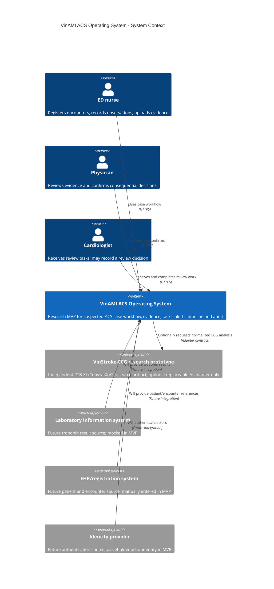

# System Context

## Purpose

VinAMI ACS Operating System coordinates the review workflow for a suspected ACS case. It records evidence, creates review work, and makes every decision traceable. It is a research and engineering MVP, not a medical device, AMI rule-out product, guideline engine, or autonomous activation system.

Every UI surface that exposes a demo rule must display: **"Demonstration rule - not for clinical use."**

## System Boundaries

- VinAMI owns the ACS case, workflow, ruleset version, task, alert, timeline, audit event, model provenance, and references to clinical evidence.
- VinAMI does not claim diagnostic truth, rule out AMI, activate a cath lab, interpret ESC/AHA guidelines, or replace a clinician.
- Patient identity and laboratory/EHR integration are manually entered or mocked in the MVP. They are designed as adapters, not copied as external source-of-truth data.
- VinStroke-ECG is preserved as an independent research prototype. It may provide a normalized result, but has no authority to alter ACS workflow by itself.

