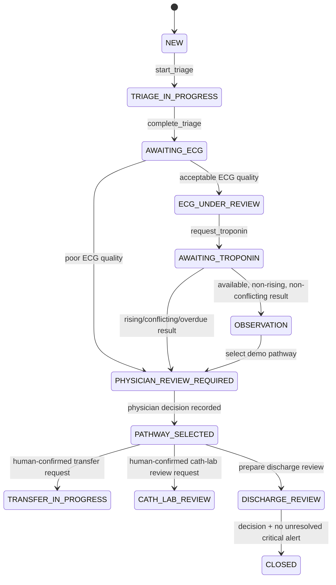

# Workflow Engine

## Purpose

Sprint 5 introduces the core VinAMI ACS workflow capability as a versioned state machine. It coordinates operational review work for a suspected ACS case; it does not diagnose AMI, rule out AMI, activate a cath lab, or replace a physician.

Every loaded definition carries the exact notice: **Demonstration workflow — not for clinical use.** The checked-in JSON definition contains no clinical thresholds.

## Model

`WorkflowDefinition` contains named `Transition` entries. A transition declares its source state, destination state, command type, named guards, and named effects. `WorkflowEngine` resolves the configured transition and guard/effect registries without a nested clinical `if/else` decision tree.

`ClinicalWorkflow` owns current state, facts, optimistic version, accepted command IDs, transition history, due timers, generated task instructions, and generated alert instructions. A repeated command ID is a no-op acknowledgement; a new command with a stale version is rejected.

## Safety Guards

| Guard | Enforced outcome |
|---|---|
| ECG quality unacceptable | Blocks normal AI interpretation and creates a physician-review task and alert. |
| Troponin unavailable or repeat ECG overdue after a persisted due time | Moves or remains in physician review with an overdue-item alert. |
| Rising troponin or conflicting signals | Moves to physician review; never selects a pathway automatically. |
| No ECG-only closure route | The demo close route requires a recorded troponin fact and physician decision before discharge review. |
| Cath-lab review | Requires a recorded physician decision and creates only a review task. |
| Closing | Requires a physician decision and zero unresolved critical alerts. |

## Durable Effects

The repository writes the workflow row, transition history, command receipt, due timer changes, generated `clinical_tasks`, generated `alerts`, and outbox events in one PostgreSQL transaction. Task/alert effect IDs are deterministically derived from workflow, command, and effect names, with unique persistence constraints as a second duplicate-delivery defense.

The worker scans persisted due timers, converts each to an idempotent `timer_due` command, records its state transition, then marks the timer complete in the same transaction. It separately dispatches the transactional outbox for timeline/audit projection.

## Current Limits

The workflow is a research-MVP demonstration. It has no clinician-authored guideline content, no API/UI command surface yet, no external escalation integration, and no clinical validation. Its facts are deliberately generic workflow inputs, not a substitute for clinical interpretation.
