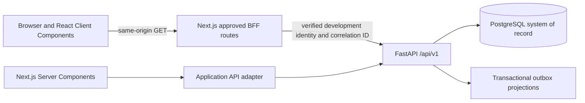

# F0/R2/R3 Frontend Architecture

## Purpose

F0 is a Next.js App Router client for the verified R1 lifecycle only. The browser never accesses PostgreSQL, Python domain modules, workflow rules, or model runtimes.

## Boundaries

- `app/` owns routing, composition, route-level loading and failure boundaries.
- `features/` owns user-facing R1 use cases and transport-to-view mapping.
- `entities/` owns presentation models, not backend domain entities.
- `widgets/` owns stable page composition such as the clinical shell.
- `shared/` owns framework adapters, validation, formatting, query policy and reusable presentation behavior.
- `packages/contracts` is generated from the canonical FastAPI OpenAPI snapshot.
- `packages/api-client` wraps generated contracts with timeout, safe GET retry, RFC 7807 mapping and correlation IDs.
- `packages/ui` owns token-driven, side-effect-free primitives.

All application routes are dynamically rendered so actor-specific identity and clinical records are not embedded during image build. TanStack Query owns interactive server state; local React state owns filters and row selection. Runtime Zod validation rejects malformed responses before rendering.

R2 adds `entities/clinical-documentation` and `features/clinical-documentation`. The server feature loads the backend summary and immutable histories; the Client Component owns form state and invokes only generated API-client methods. Four POST paths are separately allow-listed by the BFF. The browser supplies idempotency and correlation references but never supplies a trusted actor identity.

R3 adds `entities/ecg` and `features/ecg`. The server loads the normalized ECG workspace contract, while browser commands use the same allow-listed BFF for multipart ingestion, analysis, and physician interpretation. Presentation receives typed view models and renders waveform, technical quality, serial evidence, five independent label scores, provenance, and append-only review. It contains no provider, threshold, database, or clinical decision logic.

## Enforced Rules

Architecture tests prohibit Python/ORM/model imports, server-only imports from Client Components, local-storage access tokens, future clinical routes and prohibited autonomous clinical claims in production UI source.

# R6 workflow workspace

`/cases/[caseId]/workflow` is an API-only operational view over the case-owned workflow,
tasks, alerts, and immutable histories. It combines the generated R6 contract with R5
decision references; it never calculates task authority, overdue state, escalation, or
clinical conclusions in the browser. Mutations use correlation-aware BFF forwarding,
persistent idempotency keys, and server-supplied aggregate versions.

## R7 Advanced Command Center

`/command-center` consumes one generated `/api/v1/command-center/cases` projection.
The backend owns operational priority, evidence state, effective physician authority,
R6 overdue and escalation state, stable sorting, visibility and pagination. The browser
only renders server timestamps and update tokens, maintains filter/selection state, and
links to specialized case workspaces. No queue component queries persistence, derives a
clinical conclusion, or creates tasks, alerts, workflow transitions or evidence records.
