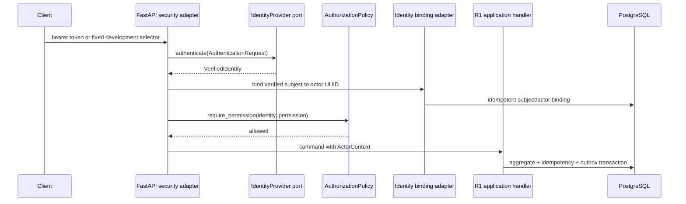

# R1.5 Identity Binding and Authorization Foundation

## Boundary

R1.5 secures the nine real R1 lifecycle endpoints. It does not add clinical features,
frontend behavior, custom password storage, or a live hospital identity integration.

`ActorContext` is authoritative only after the provider has verified an identity. The API
ignores `X-Actor-ID` and `X-Actor-Role`. Safe audit provenance includes subject, roles,
permission, provider, authentication method, request source, and correlation ID. Raw
access tokens and secrets are never persisted.

## Modes

| Mode | Credential | Acceptance behavior | Claim |
|---|---|---|---|
| `development` | `X-Development-Identity` | Only eight fixed synthetic identities | Development only |
| `oidc` | `Authorization: Bearer ...` | JWKS signature and registered claims verified | Production-shaped adapter only |

`VINAMI_IDENTITY_MODE` must be explicitly configured. Development mode is rejected when
`VINAMI_APP_ENVIRONMENT` is `production` or `prod`.

## OIDC Verification

The adapter verifies signature, issuer, audience, expiration, optional not-before, and a
configured signing-algorithm allow-list. `PyJWKClient` caches JWKS and refreshes keys when
the token key identifier changes. Known external roles and permissions are normalized;
unrecognized roles cannot create an internal actor.

No live hospital issuer was configured or tested in R1.5. Readiness therefore reports
that OIDC configuration is valid, not that an enterprise SSO deployment has been proven.
