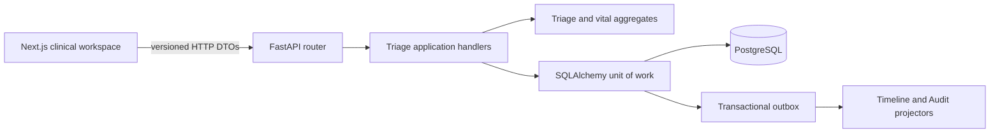
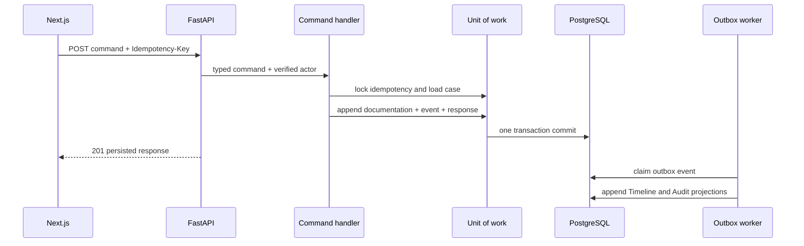

# R2 Design: Triage and Vital Documentation

## Scope and Safety

R2 adds factual clinical documentation to an existing suspected-ACS case. It does not diagnose, score risk, interpret vital signs, select a pathway, or apply a clinical threshold. The documentation completeness policy identifies missing fields only.

The slice follows the existing modular-monolith boundaries:

## Domain Decisions

- `TriageAssessment` is an append-only aggregate revision. A correction creates a new ID, increments revision/version, references the corrected assessment, and requires a reason.
- `VitalObservationSet` groups observations captured together. Repeated measurement sets increment the sequence; corrections retain the sequence and append a revision.
- `StructuredObservation` distinguishes `present`, `absent`, `unknown`, and `not_assessed`.
- `VitalMeasurement` requires a finite value, UTC timestamp, source, quality declaration, and an explicit unit allowed for its observation kind.
- Closed cases reject routine documentation.
- Command handlers validate the persisted actor, persistent idempotency key, parent case, expected version, and correction target.

## Completeness

Policy `r2-documentation-v1` reports only:

1. Chief complaint not documented.
2. Symptom onset not assessed.
3. No initial vital set.

These are documentation gaps, not clinical abnormalities. Policy evaluation runs in the backend and the frontend renders its output without reimplementing it.

## Command Flow

## Prohibited Dependencies

The domain imports no FastAPI, SQLAlchemy, Streamlit, database session, or AI runtime. Next.js imports no Python module, repository, database code, workflow rule, or model runtime. Browser commands pass through an allow-listed same-origin BFF; server configuration supplies the development identity.
