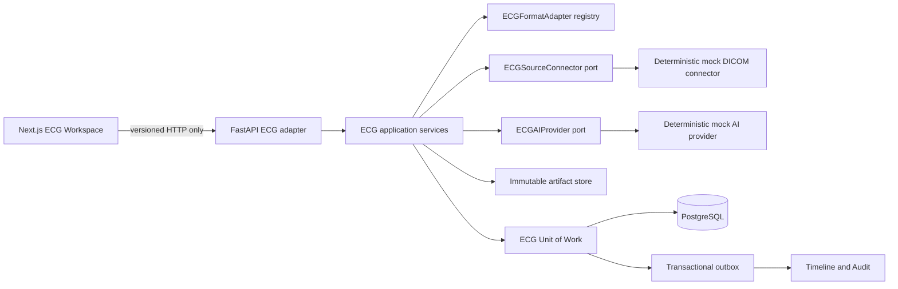

# R3 ECG Intelligence Architecture

Recorded: 2026-07-14 (Asia/Saigon).

## Component Boundary

Routers parse transport DTOs only. DICOM/XML/PDF parsing, waveform normalization, comparability metrics and reminder invariants live outside FastAPI and Next.js. Domain and workflow code do not import `torch`, DICOM, XML, ORM or UI libraries.

## Ingestion

`ECGIngestionJob` is the durable command trace. Local artifacts pass through a format-adapter registry; source references pass through `ECGSourceConnector`. Raw artifacts are checksum-addressed and immutable. Failed jobs remain queryable, safe retry increments the same traceable job, and a completed retry does not duplicate the ECG study.

Supported local profiles are DICOM Part 10 waveform through `pydicom`, canonical JSON, canonical XML namespace `urn:vinami:ecg:canonical:1`, and PDF document-only. The mock DICOM connector is deterministic and explicitly says no live hospital system is connected.

## Dynamic ECG

Studies are ordered by acquisition time, then ingestion time, then stable identifier. A comparison first evaluates waveform availability, lead overlap, sampling rate, unit, quality, preprocessing and model provenance. Non-comparable studies do not receive waveform metrics or misleading score deltas.

Comparable leads receive deterministic, versioned technical metrics only. Outputs are neutral and persist the safety text: “Technical ECG change indicator — physician interpretation required.” Score evolution is calculated only for compatible finding codes, model version, preprocessing and threshold provenance. Physician comparison reviews are append-only; corrections supersede rather than overwrite.

## Repeat ECG

Reminder origins are physician request, technical quality or explicit demonstration policy. Model score is not an origin. Schedule, due/overdue, acknowledge, complete and cancel transitions carry actor, correlation, idempotency and optimistic version data. Completion requires a subsequent ECG study.

## Persistence

Migration `c8a4e7f2d913` extends ingestion provenance and retry state, adds immutable Dynamic ECG physician reviews, and completes reminder lifecycle fields and indexes. It is a non-destructive successor to `b7f3a9d1e6c2`.

## Deferred Boundaries

No live PACS/DICOMweb connection, production credentials, real ConvNeXtV2 runtime, real Grad-CAM, model training, production authentication, clinical validation or regulatory validation was exercised.
