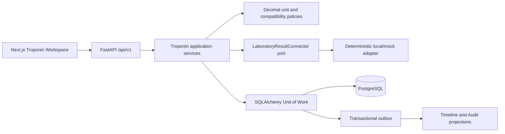

# R4 Design - Serial Troponin Evidence

## Boundary

R4 adds a laboratory-evidence vertical slice to an existing Clinical Case. It records measurements and provenance; it does not diagnose AMI, choose a pathway, recommend treatment, activate cath-lab review, or close a case.

## Invariants

- Original value/unit are immutable and separate from normalized value/unit.
- Measurements use `Decimal` and PostgreSQL `NUMERIC(30,10)`.
- A reference limit is optional, but its value and unit must be supplied together. None is ever inferred.
- Result time cannot precede specimen collection time.
- Same-analyte, same-assay-version, normalized-unit-compatible results alone receive a numerical delta.
- Relative change is unavailable for a zero baseline.
- Amendment creates a linked replacement and retains the original.
- Clinician review is append-only and has no workflow authority.
- Repeat measurement originates from an explicit clinician review; no value or timing threshold triggers it.
- Closed cases reject evidence mutation.

## Integration profile

`vinami-local-lab-result-v1` is a narrow deterministic JSON-shaped profile parsed outside FastAPI. It is not an HL7 v2 or FHIR implementation and is not connected to a live LIS. The connector port can be replaced without changing domain or workflow modules.

## Data ownership

Troponin owns assay definitions, immutable evidence results, import jobs, clinician troponin reviews and repeat-measurement requests. Clinical Case owns lifecycle. Timeline and Audit own projections. Workflow and Reasoning do not consume R4 deltas in this release.
